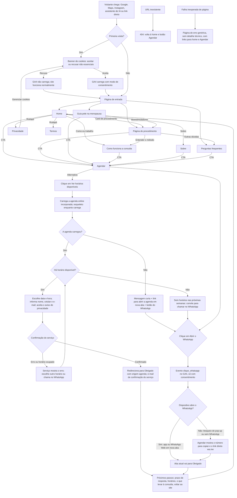

# App Flow — Dra. Mariana Santiago

> Gerado a partir do BRIEF.md (modo protótipo, premissas de 22/10/2026), de `docs/PERSONAS.md` e de `docs/CONCORRENTES.md`.
> **Harness regulatório v1.3 aplicado.** Nenhuma rota, slug, título ou palavra-chave usa "dermatologia/dermatologista/especialista" (R2). Nenhuma página oferece tratamento de doença (R3). Não há páginas de resultados, depoimentos ou preços de procedimento (R6–R8). A identificação "Dra. Mariana Passos Santiago · MÉDICA: CRM-SP 227636" aparece no rodapé de todas as páginas e na home (R1).
> Agendamento: **CTA principal = WhatsApp** em todo o site. **Alternativa = agenda online** (serviço tipo Calendly) dentro de /agendar. O site não tem banco de dados próprio: os dados do agendamento online ficam no serviço contratado, que atua como operador (R15). Nenhum dado de saúde é coletado (R12).

## Páginas

| Rota | Página | Persona / crenças que sustenta | Palavra-chave principal (PREMISSA, sem pesquisa de volume) | Indexar |
| --- | --- | --- | --- | --- |
| / | Home | A (principal); U1, U2, U6 na primeira dobra | médica procedimentos estéticos Av. Paulista | Sim |
| /como-funciona | Como funciona a consulta (método e planejamento no tempo) | Todas; U2, U3, U5, U7 (peça central) | avaliação estética facial individualizada São Paulo | Sim |
| /procedimentos | Procedimentos (índice) | Todas; U4 | procedimentos estéticos faciais Av. Paulista | Sim |
| /procedimentos/toxina-botulinica | Toxina botulínica | A | toxina botulínica Av. Paulista | Sim |
| /procedimentos/preenchimento-labial | Preenchimento labial | C | preenchimento labial São Paulo | Sim |
| /procedimentos/contorno-facial | Contorno facial com ácido hialurônico ("full face") | B, D | preenchimento facial ácido hialurônico São Paulo | Sim |
| /procedimentos/bioestimuladores-de-colageno | Bioestimuladores de colágeno | B | bioestimulador de colágeno São Paulo | Sim |
| /procedimentos/skinbooster | Skinbooster | C | skinbooster São Paulo | Sim |
| /procedimentos/peelings | Peelings | C | peeling químico São Paulo | Sim |
| /guias/pele-na-menopausa | Guia educativo: o que muda na pele na menopausa | B | pele na menopausa | Sim |
| /sobre | Sobre a Dra. Mariana | Todas; U1 + "séria o suficiente" (B) | Dra. Mariana Santiago médica | Sim |
| /perguntas-frequentes | Perguntas frequentes (FAQ priorizado em `PERSONAS.md`) | Todas; D; crenças residuais | (cauda longa: uma pergunta por bloco) | Sim |
| /agendar | Agendar consulta: o que acontece; **botão principal do WhatsApp**; abaixo, "Prefere escolher o horário sozinha? Ver horários disponíveis" (agenda online) | Todas; U6, U7 | agendar consulta Dra. Mariana Santiago | Sim |
| /obrigado | Obrigado (próximos passos; registra a conversão) | — | — | Não (noindex) |
| /privacidade | Política de privacidade (LGPD, R15) | — | — | Sim |
| /termos | Termos de uso | — | — | Sim |
| (rota inexistente) | 404 com volta à home e ao agendar | — | — | Não |

**Componentes globais em todas as páginas:** cabeçalho (logo, Como funciona, Procedimentos, Sobre, Perguntas, botão "Agendar consulta"); rodapé com identificação R1, endereço, horários, links legais e redes; **CTA fixo no celular** ("Agendar consulta"); banner de cookies na primeira visita.

**Seções da home (ordem do desktop):**
1. Hero: proposta de valor + CTA + identificação curta + horários.
2. Como eu trabalho: 3 passos (conversa → avaliação → plano).
3. Procedimentos: 6 cards educativos.
4. Planejamento no tempo: quanto antes começar cada procedimento.
5. Sobre (resumo factual).
6. Perguntas frequentes (5 principais).
7. Onde e quando: mapa, horários, metrô.
8. CTA final.

No celular, a seção "Onde e quando" sobe para logo depois do hero (U6). A decisão de ordem fica para o DESIGN.md.

## Fluxo principal

## Estados exigidos pelo kit

| Estado | Onde | Comportamento |
| --- | --- | --- |
| **404** | Qualquer rota inexistente | Visual do site, mensagem curta, botões "Voltar à página inicial" e "Agendar consulta" (item 1 do checklist de produção) |
| **Carregando** | /agendar, depois do clique | O botão muda para "Abrindo o WhatsApp…" por até 2 s antes de ir para /obrigado. Não há formulário nem chamada a servidor no protótipo, então não há outros estados de carregamento. Imagens com tamanho reservado para evitar saltos de layout |
| **Erro** | /agendar | Se a nova aba não abrir (pop-up bloqueado, desktop sem WhatsApp), aparecem o número (11) 3192-2635 com botão "copiar" e o link wa.me. O caminho nunca termina sem saída |
| **Erro genérico** | Qualquer página | Página de erro com mensagem genérica (item 11 do checklist de segurança) e links para home e Agendar |
| **Carregando (agenda online)** | /agendar | A agenda só é carregada depois do clique em "Ver horários disponíveis", o que evita cookies de terceiros antes da escolha da paciente. Enquanto carrega, aparece um esqueleto com a altura reservada |
| **Erro (agenda online)** | /agendar | Falha ao carregar: link para abrir a agenda em nova aba + WhatsApp. Sem horários: convite para o WhatsApp. Horário tomado na confirmação: o serviço pede outro horário |
| **Obrigado** | /obrigado | Confirma que o WhatsApp foi aberto, diz o próximo passo ("a mensagem chega pelo WhatsApp; respondemos em horário de atendimento" **[confirmar prazo]**), lembra o que levar e registra a conversão. Também funciona com acesso direto, sem quebrar |
| **Cookies** | Primeira visita; link "Gerenciar cookies" no rodapé e na Privacidade | Aceitar e recusar no mesmo nível; nada não essencial antes do aceite (R15) |

## Caminhos sem saída: verificação

- Todas as páginas de conteúdo têm CTA "Agendar consulta" e links para "Como funciona" e "Perguntas frequentes". ✅
- /obrigado volta à home. ✅
- 404 e erro genérico levam à home e ao Agendar. ✅
- Falha ao abrir o WhatsApp tem alternativa (número + link). ✅
- Páginas legais têm cabeçalho e rodapé completos. ✅
- **Ponto de atenção:** o WhatsApp é externo. Se a mensagem não for respondida, a conversão se perde fora do site. Recomendação para depois do aceite: horário de resposta declarado e, se ela quiser, a agenda online.

## Agendamento online (integração)

**Hierarquia:** todos os botões do site ("Agendar consulta", CTA fixo no celular, CTAs de página) levam ao **WhatsApp** ou a /agendar, onde o WhatsApp é o botão principal. A agenda online aparece só em /agendar, como opção secundária para quem prefere escolher o horário sem conversar. Não compete com o CTA principal.

**Regras do harness para a ferramenta (valem para qualquer serviço escolhido):**
- **Um tipo de evento: "Consulta"** (ou "Primeira consulta" e "Retorno"). Nunca "Consulta dermatologia", "tricologia" ou o nome de um procedimento (R2, R3).
- **Campos mínimos:** nome, celular (WhatsApp) e e-mail. **Sem** queixa, histórico, foto, data de nascimento nem campo livre "o que você quer tratar" (R12; dado de saúde).
- **Aviso de privacidade no formulário**, com link para /privacidade. A política lista o serviço como operador e informa a **transferência internacional** se os servidores ficarem fora do Brasil (LGPD, art. 33) (R15).
- **Incorporar só depois do clique** (sem cookies de terceiros antes da escolha) ou abrir em nova aba (R15).
- Confirmações e lembretes **só administrativos** (data, hora, endereço, como chegar, política de cancelamento), com a identificação "MÉDICA · CRM-SP 227636". Nada de conteúdo clínico nem automação que responda dúvidas de saúde (R11).
- **Sem pagamento antecipado** no protótipo. Se for adotado depois, só o valor da consulta e nunca pacote ou procedimento (R8).
- Lembretes por WhatsApp automáticos só com consentimento e conteúdo administrativo.

**Opções comparadas (preços e recursos conferidos em fontes de terceiros em 22/10/2026; reconfirmar na contratação):**

| Opção | Prós | Contras | Custo aproximado |
| --- | --- | --- | --- |
| **Agenda online da Clinovi** (já existe no site atual) | Já ligada à sala e ao horário dela no prédio, sem risco de marcar quando a sala não está reservada; zero custo adicional | Visual genérico e pouco controle; hoje pede data de nascimento e usa tipos "Consulta Dermatologia/Tricologia" (🔴 R2), que precisariam ser renomeados; sem aviso LGPD; não se sabe se pode ser incorporada | Incluído no plano Clinovi `[confirmar]` |
| **Cal.com** | Plano gratuito com tipos de evento ilimitados, notificações por e-mail e incorporação no site; redirecionamento ao concluir `[verificar]` | Marca Cal.com no gratuito; servidores fora do Brasil (transferência internacional) | Grátis; equipe a partir de US$ 12/usuário/mês |
| **Calendly** | Conhecido e simples | Gratuito com só 1 tipo de evento ativo e sem lembretes automáticos; marca Calendly | Grátis limitado; pago a partir de US$ 10–12/usuário/mês |
| **Google Agenda (página de agendamento)** | Gratuito com conta Google; perguntas personalizadas; integra a agenda pessoal | Lembretes programados e várias páginas só no plano pago (Workspace/Google One Premium); incorporação no site `[verificar]` | Grátis básico; Workspace pago |
| **Software médico brasileiro** (ex.: Feegow, iClinic, Ninsaúde) | Agenda + prontuário + lembretes por WhatsApp; empresa brasileira | Assinatura mensal; mais do que o protótipo precisa; integração com a sala da Clinovi `[verificar]` | Pago `[cotar]` |
| Doctoralia (agenda) | Visibilidade e citação por IA | Exibe avaliações públicas (🟡 R7) | Pago |

**Decisão (22/10/2026, responsável): Calendly**, no protótipo e como recomendação final à lead.

1. **No protótipo:** conta do **Calendly** em nome do João, marcada "demonstração", com **um tipo de evento "Consulta"** (o plano gratuito permite só um ativo, o que basta) e horários fictícios. A lead vê a experiência sem que nenhuma consulta real seja marcada.
2. **Integração técnica:** incorporação *inline* do Calendly carregada só depois do clique. O site escuta o evento de agendamento concluído que o embed envia à página (`calendly.event_scheduled`) e leva a aba para `/obrigado?origem=agenda`. Assim não dependemos do redirecionamento nativo do Calendly, que pode ser recurso pago `[verificar]`. Plano B: abrir em nova aba. Idioma do embed em português `[verificar]`.
3. **Para a recomendação final à Dra. (depois do aceite):**
   - **Plano:** o gratuito atende a demonstração, mas lembretes automáticos e remoção da marca Calendly são pagos (cerca de US$ 10–12/usuário/mês, reconfirmar). Lembretes reduzem faltas, então a recomendação natural é o plano pago.
   - **Sala na Clinovi:** conectar o Calendly à agenda que ela usa (Google Agenda, por exemplo) e bloquear ali os horários sem sala reservada, para evitar marcação sem sala. **[confirmar modelo da sala]**
   - **Tipos de agendamento da Clinovi:** desativar ou renomear "Consulta Dermatologia/Tricologia" para não haver dois canais com nomes conflitantes (🔴 R2).
   - **LGPD:** o Calendly armazena dados fora do Brasil, então a política de privacidade informa a transferência internacional (art. 33) e cita o Calendly como operador (R15).
   - Conta **no nome da Dra.**, com os termos de tratamento de dados do Calendly arquivados.

## Mensagem pré-preenchida do WhatsApp (R12)

> "Olá! Vim pelo site e gostaria de agendar uma consulta."

Neutra, sem lista de queixas nem de doenças. A atual pede a queixa principal ("papada, flacidez, … acne, manchas") e não é usada.

## Eventos de analytics (só com consentimento: R13, R15)

| Evento | Quando | Parâmetros |
| --- | --- | --- |
| `clique_whatsapp` | Clique em qualquer CTA de agendamento | `origem` (home_hero, cta_fixo, pagina_procedimento, etc.). **Sem nome de procedimento** que revele interesse em saúde a terceiros |
| `clique_agenda_online` | Clique em "Ver horários disponíveis" | `origem` |
| `agendamento_concluido` | Retorno da agenda online para /obrigado (`?origem=agenda`) | — |
| `view_obrigado` | Carregamento de /obrigado | `origem` (whatsapp ou agenda) |
| Canal de IA | Grupo de canais para chatgpt.com, perplexity.ai, gemini.google.com, claude.ai, copilot.microsoft.com | Configuração no GA4 (PUBLICACAO.md) |

## Harness: conferência desta etapa

| Regra | Verificação | Resultado |
| --- | --- | --- |
| R1 Identificação | Rodapé global + home | Previsto |
| R2 Especialidade | Rotas, títulos e palavras-chave sem termos proibidos; "contorno facial" no lugar de "harmonização" | OK |
| R3 Doenças | Nenhuma página de "acne", "melasma" etc.; menções só educativas dentro de peelings e FAQ | OK |
| R4/R5 Promessa e sensacionalismo | Páginas de procedimento com estrutura obrigatória: indicação, tempo de resposta, cuidados, possíveis complicações | Previsto (verificar no texto) |
| R6/R7 Imagens e depoimentos | Sem página de resultados nem de depoimentos | OK |
| R8 Preços | Sem preço de procedimento; valor da consulta fora do protótipo | OK |
| R11 IA e consulta a distância | Sem quiz, sem chatbot, sem análise de foto | OK |
| R12/R15 Dados | Sem formulário próprio; WhatsApp neutro; agenda online com campos mínimos, aviso de privacidade, carregamento depois do clique e transferência internacional informada; cookies com recusa | OK (verificar a configuração da ferramenta) |
| 🟡 pendentes | Menção à residência em /sobre; redação do "retorno em 15 dias"; link para o perfil do Google | Decidir antes da copy |

**Harness: sem alertas bloqueantes nesta etapa.**
