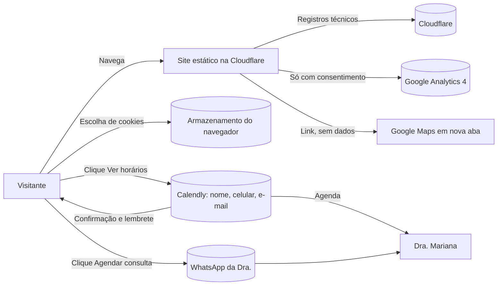

# SCHEMA.md — Dra. Mariana Santiago

> Derivado do APP_FLOW.md (modo protótipo). **O site não tem banco de dados próprio, login nem formulário.** Por isso, seguindo o modelo do kit para sites sem formulário, este arquivo registra **para onde vão os dados** de quem usa o site, quem trata cada um e por quanto tempo.
> **Harness regulatório v1.3 aplicado** (R11, R12, R13, R15).
> Este arquivo descreve o tratamento de dados da cliente: tratar como confidencial.

## Papéis (LGPD)
- **Controladora:** a Dra. Mariana Passos Santiago (pessoa física, consultório próprio). No protótipo, as contas de demonstração são do João, sem dados reais de pacientes.
- **Operadores:** Calendly (agenda online), Meta/WhatsApp (mensagens), Google (Analytics e Mapa), Cloudflare (hospedagem e registros técnicos).
- **Canal do titular:** e-mail de contato publicado na Política de Privacidade (`[A CONFIRMAR]`: criar e-mail no domínio; hoje ela usa um Gmail pessoal).

## Fluxos de dados

| Fluxo | Dados | Quem guarda | Finalidade | Base legal (LGPD) | Retenção | Observações do harness |
| --- | --- | --- | --- | --- | --- | --- |
| **Clique no WhatsApp** (CTA principal) | Nenhum dado passa pelo site. A conversa acontece no WhatsApp, com o número e o nome do perfil da paciente | Meta (WhatsApp) e o celular da Dra. | Agendar a consulta | Procedimentos preliminares a pedido do titular (art. 7º, V) | **12 meses a partir do último contato da paciente** (decisão de 22/10/2026); depois, apagar a conversa | Mensagem pré-preenchida neutra, sem queixa (R12). Respostas só administrativas; nada de diagnóstico ou indicação pelo WhatsApp (R11, CEM art. 37). Sigilo da equipe (CEM, arts. 73 e 78) |
| **Agenda online** (Calendly, alternativa) | Nome, celular e e-mail; data e hora escolhidas | Calendly (servidores fora do Brasil) | Marcar a consulta e enviar confirmação e lembrete | Procedimentos preliminares (art. 7º, V) | **12 meses a partir do último contato da paciente** (decisão de 22/10/2026); depois, excluir o registro | **Sem** campo de queixa, histórico, data de nascimento ou foto (R12). Tipo de evento "Consulta" (R2). **Transferência internacional** informada na política (art. 33). Carregado só depois do clique (R15) |
| **Analytics** (GA4) | Identificador pseudônimo, páginas vistas, origem do acesso, eventos `clique_whatsapp`, `clique_agenda_online`, `agendamento_concluido`, `view_obrigado` | Google | Medir visitas e conversões | Consentimento (art. 7º, I), coletado no banner | 14 meses (configuração do GA4) | Carrega **só depois do aceite**. Eventos **sem nome de procedimento** (evita inferir interesse de saúde: R13). IP anonimizado pelo GA4 |
| **Preferência de cookies** | Escolha "aceitar" ou "recusar" | Navegador da visitante (armazenamento local) | Lembrar a escolha | Legítimo interesse ou cumprimento de obrigação (art. 7º, II e IX) | Até a visitante limpar o navegador; pedir de novo em 12 meses | Link "Gerenciar cookies" no rodapé e na Política |
| **Mapa** (Google Maps) | Ao carregar o mapa interativo: IP e cookies do Google | Google | Mostrar a localização | Consentimento | Política do Google | **Protótipo: mapa estático (imagem) com link "Abrir no Google Maps"**; nenhum dado sai sem clique |
| **Hospedagem** (Cloudflare) | IP, navegador e data/hora em registros técnicos | Cloudflare | Segurança e funcionamento | Legítimo interesse (art. 7º, IX) | Conforme o plano da Cloudflare | Sem análise individual |
| **Vídeos e fontes** | Nenhum dado pessoal | Próprio site | — | — | — | Vídeos e fontes **hospedados no próprio site** (sem YouTube nem Google Fonts por CDN), para não enviar IP a terceiros antes do consentimento |

## Diagrama

## SQL
Não se aplica: não há banco de dados próprio no protótipo.

**Se um formulário ou banco entrar no futuro** (por exemplo, a automação de WhatsApp ou a gestão do consultório, registradas em `claude/argumentos-venda.md`), voltar ao modelo do kit:
- tabela com o mínimo de campos;
- RLS ativo, com inserção só com consentimento e nenhuma leitura anônima;
- chave de serviço só no servidor;
- **nenhum dado clínico fora do prontuário eletrônico** (normas do CFM sobre prontuário).

## Itens para a Política de Privacidade (alimentam a etapa de páginas legais)
1. Controladora, contato e canal do titular.
2. Cada fluxo da tabela acima: dados, finalidade, base legal e retenção (padrão: **12 meses a partir do último contato** para WhatsApp e agenda).
3. Operadores nomeados (Calendly, Meta/WhatsApp, Google, Cloudflare) e **transferência internacional** (Calendly, Google, Cloudflare).
4. Cookies: lista, finalidade, como recusar e como mudar a escolha.
5. Aviso de que o site não coleta dados de saúde e de que dúvidas clínicas são tratadas só em consulta.
6. Direitos do titular (art. 18) e como exercê-los.
7. Data da última atualização.

## Cuidados
- Contas de demonstração (Calendly, GA4) **no nome do João só no protótipo**. Depois do aceite, migrar para contas no nome da Dra. (regra do kit) e apagar os dados de demonstração.
- Nenhuma chave ou token no código; o ID do GA4 e o link do Calendly entram por variável de ambiente pública (não são segredo, mas ficam fora do código para trocar sem novo commit).
